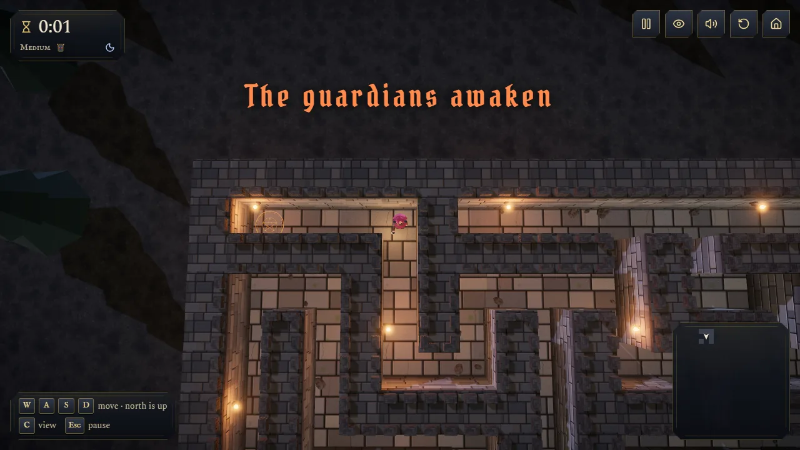
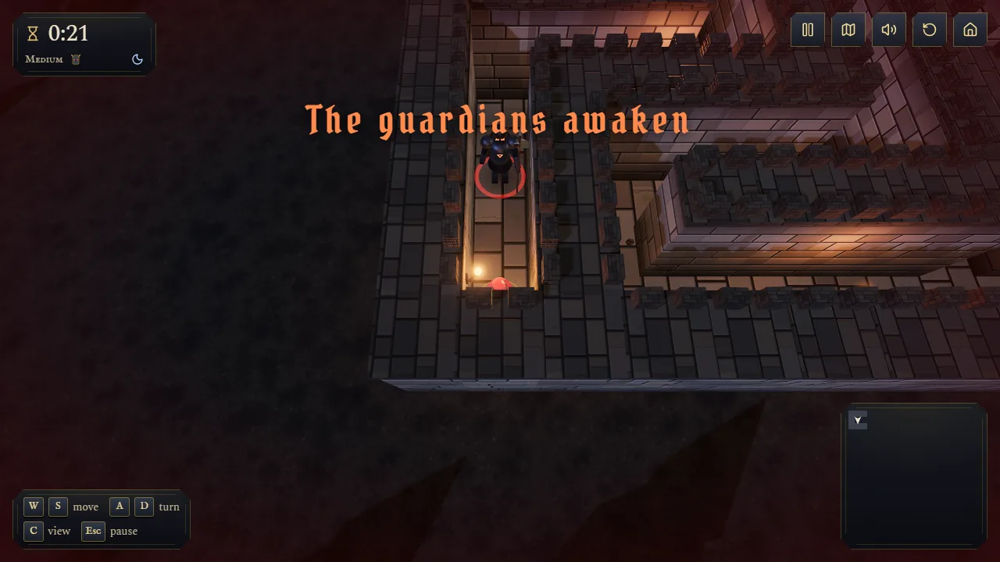
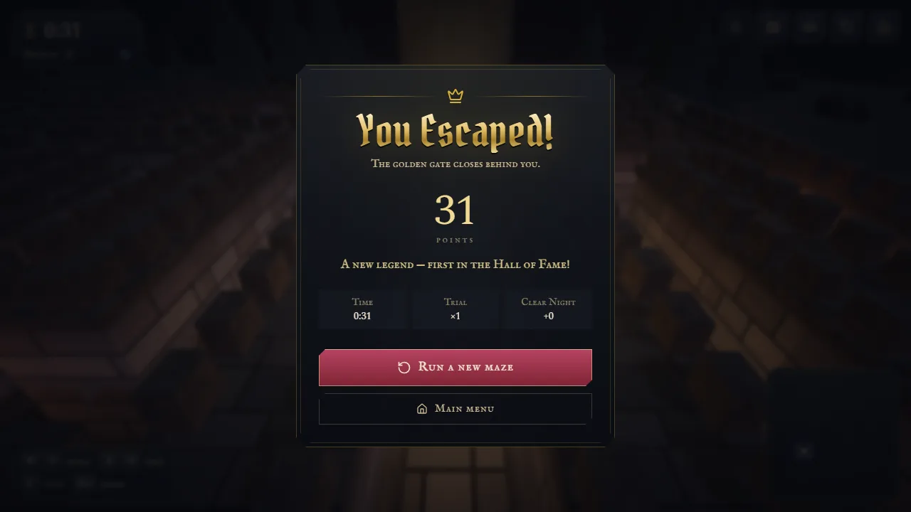
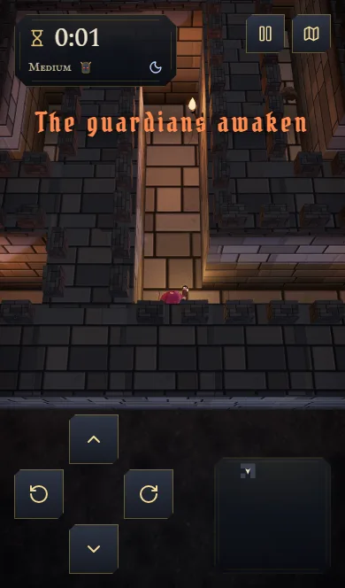

<p align="center">
  <a href="https://juliancallejas.github.io/a-mazing-run/">
    
  </a>
</p>

<h1 align="center">A-mazing Run</h1>

<p align="center">
  Escape the cursed labyrinth before its guardians wake.<br/>
  A 3D medieval maze game that runs in your browser: no account, no backend, no download.
</p>

<p align="center">
  <a href="https://juliancallejas.github.io/a-mazing-run/"><strong>Play now</strong></a>
</p>

<br/>

You wake on a rune circle inside a night castle labyrinth that is generated fresh every run. Find the golden gate before the cursed knights hunt you down. Built with React 19, React Three Fiber and Three.js. Every model, texture, sound and effect is procedural; the project ships no binary assets. It is part of the app family by { jc-develop }.

<p align="center">
  
</p>

---

## How to play

Reach the golden gate before a guardian catches you. The faster you escape, the higher your score.

| Keys | Chase view | Map view |
| --- | --- | --- |
| `W` / `↑` | Walk forward | Move north |
| `S` / `↓` | Walk back | Move south |
| `A` / `←` | Turn 90° left | Move west |
| `D` / `→` | Turn 90° right | Move east |
| `C` | Switch to map view | Back to chase view |
| `Esc` / `P` | Pause | Pause |

- **Mouse wheel** zooms the chase camera.
- **Touch devices** get an on-screen pad. It sends the same game intents as the keyboard.
- **Holding a direction** keeps you running.
- **A turn pressed early** is remembered and taken at the next tile.

| Danger | Victory | Mobile |
| --- | --- | --- |
|  |  |  |

### Rules

- **Maze:** 10×10 to 100×100 cells (0 path, 1 wall, 2 start, 3 exit), with complete wall collision. Size depends on difficulty: 15, 21, 27 or 33.
- **Movement:** one tile every 0.4 s.
- **Guardians:** A* pathfinding, after a short grace period. Easy and Medium have 1 guardian; Hard and Very Hard have 2. Their speed is 80%, 90%, 100% or 110% of yours.
- **Score:** `multiplier × (1000 / seconds) + weather bonus`.
  - Multipliers: Easy 0.9, Medium 1, Hard 1.05, Very Hard 1.1.
  - Weather bonus: Fog +179, Snow +163, Storm +147.
  - The top 10 scores are kept in `localStorage` under `amazing-run-scores`.

### What you'll see

- **World:** a night castle maze.
  - Instanced ashlar walls with battlements, worn flagstones, torches with flickering light, rubble.
  - A golden portal gate with a beacon.
  - Pine forest, horizon silhouettes, sky, stars and moon.
- **Weather:** clear night, fog, snowfall (snow settles on the castle) and storm (rain with lightning and thunder).
- **Characters:**
  - A hooded hero with a lantern that lights the corridors.
  - Armoured guardians with burning visors. Their visor, chest rune, a red ground ring and a red screen vignette all intensify as they close in.
- **HUD:** run timer, a fog-of-war minimap, event banners, pause, victory (with Hall of Fame rank) and defeat screens.
- **Audio:** procedural Web Audio.
  - Ambient drone, wind or rain, distant bells.
  - Footsteps, wall bumps, a horn when the guardians wake, thunder.
  - A heartbeat that speeds up as danger rises.

> Fonts are the only thing that calls an external service (Google Fonts, cached by the service worker after first use). Your scores never leave the browser.

---

## Install as an app (PWA)

A-mazing Run is an installable Progressive Web App and works offline after the first visit.

- **Android / Chrome, desktop Chrome and Edge:** use the download button at the top of the menu, or the browser's install icon in the address bar.
- **iPhone / iPad (Safari):** tap **Share**, then **Add to Home Screen**.
- **Updates:** when a new version is ready, a **Reload** prompt appears on the menus. It never appears during a run.
- **Offline:** the first visit installs the service worker, and the page is served from it from the next load on, so offline play works from the second visit.
- **Testing the service worker:** it is disabled in `pnpm dev` unless you run `PWA_DEV=true pnpm dev`. The reliable check is `pnpm build && pnpm preview`.

---

<p align="center">
  
</p>

<br/>

## Built with

| Area | Technology |
| --- | --- |
| App | [React 19](https://react.dev), [TypeScript](https://www.typescriptlang.org), [Vite](https://vite.dev) |
| 3D | [Three.js](https://threejs.org), [React Three Fiber](https://r3f.docs.pmnd.rs) |
| Styling | [Tailwind CSS 4](https://tailwindcss.com), [Lucide](https://lucide.dev) |
| State and routing | [Zustand](https://zustand-demo.pmnd.rs), [React Router 7](https://reactrouter.com) |
| Audio | Procedural Web Audio |
| PWA | [vite-plugin-pwa](https://vite-pwa-org.netlify.app), [Workbox](https://developer.chrome.com/docs/workbox) |
| Tests | [Vitest](https://vitest.dev), [Playwright](https://playwright.dev) (QA captures) |
| Package manager | [pnpm](https://pnpm.io) |

---

## Run it locally

You need [Node.js](https://nodejs.org) 24 and [pnpm](https://pnpm.io/installation).

```bash
git clone https://github.com/JulianCallejas/a-mazing-run.git
cd a-mazing-run
pnpm install
pnpm dev        # http://localhost:5173
```

### Scripts

| Command | What it does |
| --- | --- |
| `pnpm dev` | Dev server |
| `pnpm build` | Production build to `dist/` |
| `pnpm preview` | Serves the production build |
| `pnpm test` | Unit tests (Vitest) for the pure game core |
| `pnpm typecheck` | TypeScript, app and config |
| `pnpm lint` | ESLint, including the React Compiler hook rules |
| `pnpm generate-pwa-assets` | Regenerates every PWA icon in `public/` from `public/favicon.svg` |

---

## Architecture

```
src/
├── game/
│   ├── core/              # Pure TypeScript, no React or Three; fully unit tested
│   │   ├── maze.ts        #   seeded generator, grid helpers, BFS distances
│   │   ├── engine.ts      #   60 Hz fixed-step simulation and state machine
│   │   ├── pathfinding.ts #   A* with a binary heap
│   │   ├── controls.ts    #   key → intent mapping, camera-relative moves
│   │   ├── cameraMath.ts  #   yaw, damping, occlusion march
│   │   ├── dressing.ts    #   deterministic set dressing (torches, rubble, …)
│   │   ├── gait.ts        #   distance-driven walk cycle
│   │   ├── exploration.ts #   minimap fog of war
│   │   ├── scoring.ts / highScores.ts
│   │   └── autopilot.ts   #   deterministic QA driver
│   ├── art/               # procedural textures, atmospheres, quality tier, character builders
│   └── scene/             # R3F components: loop, camera rig, avatars, world, input, QA hooks
├── systems/               # procedural Web Audio
├── store/                 # settings-only zustand store
└── ui/                    # screens, HUD, overlays, touch controls, design-system pieces
```

- **Simulation and rendering are decoupled.** The engine advances in fixed steps. React components read engine state through refs every frame, so there are no per-frame React renders.
- **The camera has a single owner.** `CameraRig` follows the hero with damping above the wall tops and climbs to keep line of sight when a wall stands behind.
- **One quality tier per device.** Touch-first or narrow screens drop prop shadows and bloom, use a 1024 shadow map and cap DPR at 1.5. This keeps them inside the mobile render budget.

### QA tooling (debug only)

Load the app with `?debug` (for example `/?debug`) to enable:

- `window.__THREE_GAME_DIAGNOSTICS__` and `window.__mazeDiagnostics`: renderer counters.
- `window.__THREE_GAME_TEST_HOOKS__`: `seed`, `setState` and `setPausedForScreenshot`.
  - States: `active-play`, `aerial-map`, `paused`, `danger`, `victory`, `defeat`.
- `/showcase`: a character turntable.

None of these exist in normal play.

```bash
pnpm build && pnpm preview --host 127.0.0.1 --port 5188
node .claude/skills/threejs-qa-release/scripts/inspect-threejs-canvas.mjs \
  --manifest artifacts/evidence.json --url "http://127.0.0.1:5188/game?debug" --seed 42
```

---

## Deploy

Every push to `main` runs [`.github/workflows/deploy.yml`](.github/workflows/deploy.yml): lint, typecheck, tests, build and publish to GitHub Pages. In the repository, set **Settings → Pages → Source** to **GitHub Actions** once.

- **Base path:** the workflow builds with `BASE_PATH=/<repo>/`. For any host that serves the app from the domain root, build without it (`base` defaults to `/`). The router, the manifest (`start_url`, `scope`, `id`) and the service worker fallback all follow that value.
- **Client-side routing:** the workflow copies `index.html` to `404.html` so GitHub Pages serves the app on routes like `/game` or `/about`. On other hosts, configure `index.html` as the fallback for unknown paths.
- **HTTPS:** required for the service worker and install. Do not cache `sw.js` or `manifest.webmanifest` aggressively (`Cache-Control: no-cache`), or updates will not reach players.
- **Fonts:** loaded from Google Fonts and cached by the service worker after first use. Everything else is bundled.
- **Browsers:** current evergreen browsers with WebGL 2.

---

#### 🌟 Thank you for stopping by. Every labyrinth has a way out, so keep running until you find yours.

<p align="center">
<a href="https://github.com/JulianCallejas">
  
</a>
</p>
